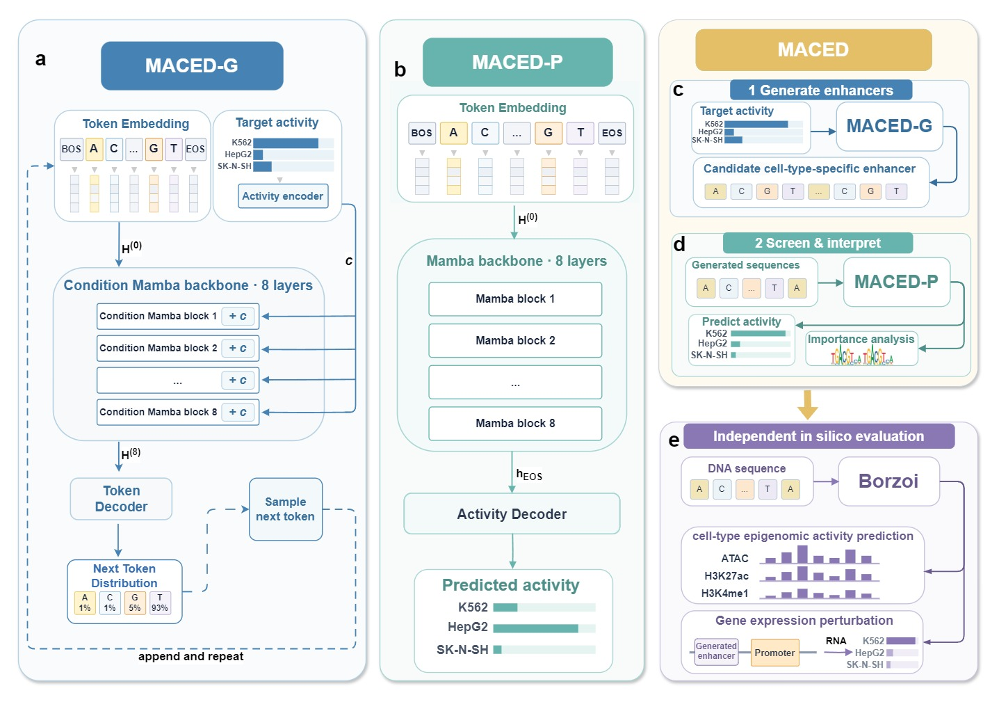

# MACED

MACED is a Mamba-based framework for enhancer activity prediction and cell-type-specific enhancer generation. It consists of two complementary modules:

- **MACED-P** predicts quantitative enhancer activity in K562, HepG2, and SK-N-SH from 200-bp DNA sequences.
- **MACED-G** generates 200-bp enhancer candidates conditioned on continuous multi-cell-type activity profiles.



## Installation

```bash
uv venv --python 3.11 --python-preference only-managed
source .venv/bin/activate

uv pip install torch==2.10.0 torchvision==0.25.0 torchaudio==2.10.0 --index-url https://download.pytorch.org/whl/cu130

wget https://github.com/state-spaces/mamba/releases/download/v2.3.2.post1/mamba_ssm-2.3.2.post1+cu13torch2.10cxx11abiTRUE-cp311-cp311-linux_x86_64.whl
wget https://github.com/Dao-AILab/causal-conv1d/releases/download/v1.7.0/causal_conv1d-1.7.0+cu13torch2.10cxx11abiTRUE-cp311-cp311-linux_x86_64.whl

uv pip install mamba_ssm-2.3.2.post1+cu13torch2.10cxx11abiTRUE-cp311-cp311-linux_x86_64.whl
uv pip install causal_conv1d-1.7.0+cu13torch2.10cxx11abiTRUE-cp311-cp311-linux_x86_64.whl

uv pip install transformers==4.57.1 pytorch-lightning pyarrow==18.1.0 audtorch h5py pandas scipy scikit-learn matplotlib seaborn pysam==0.23.0 pyBigWig==0.3.22 scanpy anndata ipykernel omegaconf
```

## Input data

MACED uses the processed Parquet files:

```text
data/df_train.parquet
data/df_valid.parquet
data/df_test.parquet
```

The main sequence and activity columns are:

```text
sequence
K562_log2FC
HepG2_log2FC
SKNSH_log2FC
```

All enhancer sequences used in the current study are 200 bp long.

## Train MACED-P

### Single GPU

```bash
python src/MACED_P/train.py --train-data data/df_train.parquet --valid-data data/df_valid.parquet --output-dir train_out/MACED_P --lr 1e-3 --seed 1215 --max-epochs 100 --patience 5 --train-batch-size 512 --valid-batch-size 1024 --num-workers 4 --devices 0
```

### Multi-GPU DDP

```bash
python src/MACED_P/train.py --train-data data/df_train.parquet --valid-data data/df_valid.parquet --output-dir train_out/MACED_P --lr 1e-3 --seed 1215 --max-epochs 100 --patience 5 --train-batch-size 512 --valid-batch-size 1024 --num-workers 4 --devices 0,1
```

## Predict enhancer activity with MACED-P

MACED-P accepts TSV, CSV, or Parquet input containing a sequence column and appends predicted enhancer activities for K562, HepG2, and SK-N-SH.

```bash
python src/MACED_P/predict.py --checkpoint checkpoints/MACED_P.ckpt --input example_data/seq.tsv --output example_data/seq_pred.tsv --sequence-column sequence --batch-size 1024 --device cuda:0
```

The output retains the original input columns and adds:

```text
pred_K562_log2FC
pred_HepG2_log2FC
pred_SKNSH_log2FC
```

## Train MACED-G

MACED-G is trained using conditional next-token prediction with activity values ordered as:

```text
K562, HepG2, SK-N-SH
```

### Single GPU

```bash
python src/MACED_G/train.py --train-data data/df_train.parquet --valid-data data/df_valid.parquet --output-dir train_out/MACED_G --lr 5e-4 --val-check-interval 5000 --max-steps 50000 --pct-start 0.01 --seed 1215 --train-batch-size 512 --valid-batch-size 1024 --num-workers 4 --devices 0
```

### Multi-GPU DDP

```bash
python src/MACED_G/train.py --train-data data/df_train.parquet --valid-data data/df_valid.parquet --output-dir train_out/MACED_G --lr 5e-4 --val-check-interval 5000 --max-steps 50000 --pct-start 0.01 --seed 1215 --train-batch-size 512 --valid-batch-size 1024 --num-workers 4 --devices 0,1
```

### Validation and checkpointing

MACED-G no longer uses a separate `--save-every-n-steps` argument. Validation and checkpoint saving are controlled by `--val-check-interval`. Each time the specified interval is reached, validation is performed and a checkpoint is saved.

For example, `--val-check-interval 5000` runs validation and saves a checkpoint every 5,000 training steps.

## Generate enhancers with MACED-G

MACED-G accepts a continuous activity vector ordered as:

```text
K562 HepG2 SK-N-SH
```

The conditions `7 0 0`, `0 7 0`, and `0 0 7` correspond to high target activity in K562, HepG2, and SK-N-SH, respectively.

### K562

```bash
python src/MACED_G/generate.py --checkpoint checkpoints/MACED_G.ckpt --activity 7 0 0 --num-sequences 10000 --sequence-length 200 --batch-size 10000 --seed 1215 --output example_data/generated_K562.tsv --device cuda:0
```

### HepG2

```bash
python src/MACED_G/generate.py --checkpoint checkpoints/MACED_G.ckpt --activity 0 7 0 --num-sequences 10000 --sequence-length 200 --batch-size 10000 --seed 1215 --output example_data/generated_HepG2.tsv --device cuda:0
```

### SK-N-SH

```bash
python src/MACED_G/generate.py --checkpoint checkpoints/MACED_G.ckpt --activity 0 0 7 --num-sequences 10000 --sequence-length 200 --batch-size 10000 --seed 1215 --output example_data/generated_SKNSH.tsv --device cuda:0
```

Change `--seed` to obtain an independent sampling run while keeping the remaining generation settings fixed.

## Score generated sequences with MACED-P

```bash
python src/MACED_P/predict.py --checkpoint checkpoints/MACED_P.ckpt --input example_data/generated_K562.tsv --output example_data/generated_K562_pred.tsv --sequence-column sequence --batch-size 1024 --device cuda:0
```

The same workflow can be used for HepG2- and SK-N-SH-conditioned sequences.
